# Web 界面改版说明

本次改版让首次使用者从页面结构识别用途、当前位置和下一步操作。采用《Don't Make Me Think》的自明导航思路，以及《写给大家看的设计书》的亲密性、对齐、重复和对比原则。实现入口为 `WebWorkspace/app/workspace-app.tsx`、`portfolio-dashboard.tsx` 和 `globals.css`。

## 阅读与操作顺序

首页按「数据来源 → 推荐下一步 → 项目摘要 → 项目详情与待处理事项 → 可展开的趋势」组织。绿色实心按钮表示当前主要行动，描边按钮表示具体入口，带下划线的文字表示次要跳转。状态色同时配有文字，不能仅凭颜色判断状态。

可编辑源为 [web-usability-flow.mmd](../diagrams/web-usability-flow.mmd)，另有 [PNG](../diagrams/web-usability-flow.png)。这是 Web 的导航与操作范围图；原有 `product-*.mmd` 描述 iPhone，不以 Web 改版覆盖。

## 原则与实际改动

| 原则 | 本次实现 |
| --- | --- |
| 不需要猜用途 | 使用「学习总览」「学习项目」「复盘」「数据与同步」；首屏说明网页用于计划与复盘，iPhone 用于练习与采集。 |
| 不需要猜下一步 | 推荐事项直接提供对应项目和页面的入口；按钮标注「查看复盘依据」「查看练习安排」等实际动作。 |
| 亲密性 | 当前阶段、目标、所需证据和证据数量放在同一项目卡片；趋势按需展开。 |
| 对齐 | 标题、卡片和操作共用内容边界；桌面主内容与待处理事项分栏，窄屏按阅读顺序排列。 |
| 重复 | 统一字体层级、间距、按钮与状态样式；项目颜色保留为识别线索。 |
| 对比 | 推荐行动有明确底色与主要按钮；统计改成轻量摘要，图表收进次要区域。 |
| 遵循浏览习惯 | 当前导航标记、项目列表返回入口、浏览器返回/前进；项目页支持方向键、Home、End 切换标签。 |
| 说明实际能力 | 移除没有响应的搜索、设置、添加和发布按钮；明确新建、采集、发布复盘在 iPhone 上完成。 |

项目列表可按名称、领域或目标搜索；无结果时提供清空搜索入口。下一步编辑保留云端版本检查，示例模式仅展示；计划草稿保留本地保存与显式启用边界。草稿面板支持焦点循环、Esc 关闭和返回触发按钮。

课程名称、学习目标、证据描述等原始内容保留原语言。中文改版覆盖导航、操作和用途说明，不构成完整多语言系统。

## 验证与验收边界

- Web 构建、67 项测试与 lint 通过。现有渲染测试核对首屏层级、数据完整性、默认折叠、导航标记、快照状态和可访问文本。
- 浏览器核对 1440 像素桌面与 390 像素窄屏：首页跳转、项目搜索与无结果恢复、返回列表、浏览器返回、标签键盘操作、草稿焦点与 Esc 关闭、个人记录未配置状态。
- 390 像素下首页、项目列表与详情未出现页面横向溢出。模拟窄屏不等于真机验收。
- 完整 `tsc --noEmit` 仍在 `worker/index.ts` 报 `Fetcher`、`D1Database` 全局类型缺失；未改动基线也产生同样两个错误。
- 尚未执行真实 CloudKit 读写、iPhone 同步、VoiceOver 或首次使用者可用性测试。

下一次验收建议：让首次接触产品的人独立找到下一步、打开一个项目、查看学习证据，并解释示例与个人记录的区别。记录发生犹豫的位置，再针对性调整。

## 参考

- [Steve Krug：《Don't Make Me Think》](https://sensible.com/dmmt.html)
- [Pearson / Peachpit：《The Non-Designer's Design Book》](https://www.pearson.com/en-us/subject-catalog/p/Williams-Non-Designer-s-Design-Book-The-4th-Edition/P200000000691?view=educator)
