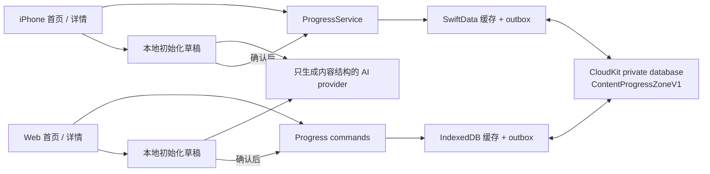

# 内容进度 MVP V0.1 实现方案

日期：2026-10-17
状态：实现方案草案，代码尚未实施
产品基线：[MVP V0.1 产品设计](../../PRODUCT_VNEXT.md)
执行入口：[分阶段实施计划](../plans/2026-10-17-content-progress-mvp.md)

## 1. 交付范围与技术决策

用户已确认：iPhone 与 Web 同期改版，并支持跨端同步。两端必须提供创建、AI 初始化、草稿编辑确认、内容进度、手动调整及暂停恢复；只完成一端或仅本地保存，均不算完成首版。

实施顺序已按用户要求调整：P0–P4 先完成 Web 与 iOS 各自的领域规则、本地持久化、页面、AI 和独立验收；P5–P7 再验证云端存储、接入同步并联合验收。以下同步架构描述最终目标，不是前半程的依赖。没有 CloudKit 账号或 token 不阻塞本地功能开发。

本方案提出以下实现决策，区别于已经确认的产品规则：

| 决策 | 采用方式 | 理由与代价 |
| --- | --- | --- |
| 客户端 | 继续 SwiftUI 与现有 Web React 工程 | 保留工具链，不另建应用 |
| 领域 | 新建 ContentProgress 模块，产品实体仍为 Project / LearningUnit | 不给旧 Project 填虚假目标或证据，不让旧日程服务解释新数据 |
| 同步 | 复用现有 CloudKit 容器与 Apple 身份，在 private database 建独立 `ContentProgressZoneV1` | 隔离旧 Journal zone；需要部署新 record schema 并验证 Web 独立建区 |
| 云端粒度 | 每个项目一个 `ContentProgressProject` record，内嵌有序单元列表 | 首版按项目做原子保存，避免排序、删除、进度的多记录半成功；同项目并发冲突较多 |
| 本地 | iPhone 使用独立 SwiftData store；Web 使用 IndexedDB 保存缓存、草稿和待同步命令 | 不改旧 Journal 协议；双端维护相同语义和 fixtures |
| AI | 复用请求传输及配置，新增只生成标题列表的 provider | 不复用旧 CoursePlanDraft、时间规划及教学提示词 |
| 历史 | 保留旧存储、附件、zone 和代码；旧模式通过附属入口访问 | 不自动迁移学习完成率，也不在新首页混排两套模型 |

首版不做历史项目自动转换。用户可以新建项目并粘贴原课程目录；这是重新初始化，不继承旧完成状态。未来转换必须有预览、来源映射和幂等标识，另行设计。

## 2. 当前代码证据与复用边界

以下依据当前任务分支实际源码检查，不代表线上环境已验证。路径相对于仓库根目录。

| 现有入口 | 已确认情况 | 本版处理 |
| --- | --- | --- |
| `Sources/PersonalLearningJournal/Domain.swift` 的 `Project` | 包含 area、goal、currentNextStep、默认时长、commitmentState 和 evidence contract | 原类型保持兼容，新类型使用命名空间 `ContentProgress.Project` |
| `JournalService.swift` | 创建、激活、记录与证据流程耦合 | 新建 ProgressService，不调用旧激活和完成服务 |
| `Planning/CoursePlanningProvider.swift` | 输入上下文含记录与证据，输出阶段和 sessions | 仅参考 provider 注入方式，不复用业务 DTO |
| `AI/StructuredAIClient.swift` | 支持注入 HTTP transport 和结构化 JSON 响应 | iPhone 复用底层 client；不使用遍历 Journal 的 AIRequestPackageBuilder |
| `AIReviewSettings.swift` | 已有 provider 配置和 KeychainAPIKeyStore | iPhone 复用安全配置，界面改成通用 AI 设置文案 |
| `Views/RootView.swift` | 四个主 Tab：Today、Courses、Trail、AI | 新根视图改成首页到详情的 NavigationStack |
| `App/SelfStudyStudioApp.swift` | 实际 `@main` 入口直接装配 JournalApplicationSession | 在此切换新 session；不能只改库里的 PersonalLearningJournalApp |
| `Views/PersonalLearningJournalApp.swift` | 另一套 app 装配含迁移和 App Lock | 检查所有入口的一致性，保留既有隐私边界 |
| `Persistence/`、`Sync/` | JournalEntity 枚举驱动存储和 mapper；CKSyncEngine client 虽可指定 zone，mapper 仍绑定旧实体 | 复用可靠实现模式；新增 Progress adapter，不能仅改 zone 名就声称可用 |
| `WebWorkspace/lib/cloudkit.ts` | 有 private database 登录、zone 配置和分页读取封装 | 抽取可复用传输，新增进度 zone bootstrap 和增量缓存适配 |
| `WebWorkspace/lib/journal-writer.ts` | 有 change tag、受约束写入和冲突结果，操作白名单限于旧业务 | 新建 progress writer，不把新操作伪装成旧 Journal 写入 |
| `Contracts/` 与 Web `journal-contract.ts` | 旧记录有严格共享契约，未知 kind 可被拒绝 | 新契约独立版本化，两端使用同一批 fixtures |

## 3. 模块与数据流



首页和详情只读取同一份进度投影。UI 不自行计算完成率、不直接写 CloudKit。AI provider 不能持有 repository，不具备修改已确认项目的入口。草稿只保存在当前端；P0–P4 确认后的项目仅本地保存，界面明确提示。P6 接入同步且完成账号归属后，正式项目才进入跨端同步。

### 3.1 拟新增模块

```text
Sources/PersonalLearningJournal/ContentProgress/
  ProgressDomain.swift               模型、命令、校验
  ProgressProjection.swift           比例与当前位置纯函数
  ProgressService.swift              提交、去重、暂停与修改规则
  ProgressRepository.swift           snapshot / commit / outbox 协议
  SwiftDataProgressRepository.swift  独立本地存储与事务
  ProgressSyncCoordinator.swift      账号隔离、上传下载、冲突状态
  ProgressCloudAdapter.swift         新 zone、mapper、change tag
  ProgressPlanProvider.swift         AI DTO、结构校验、取消
  ProgressDraftStore.swift           初始化草稿恢复
  ProgressApplicationSession.swift   按账号装配与生命周期
  Views/                            首页、详情、草稿附属流程
WebWorkspace/lib/content-progress/
  domain.ts / projection.ts / commands.ts
  repository.ts / cloud-adapter.ts / sync.ts / conflicts.ts
  plan-provider.ts / draft-store.ts
WebWorkspace/app/
  progress-app.tsx                   新版主界面
  api/progress-plan/route.ts         AI 代理，不访问 CloudKit
Sources/PersonalLearningJournal/Resources/ContentProgressContract/
  schema.json / fixtures.json        Swift 与 Web 共用的契约
```

以上均为拟建路径。新增 Swift 文件必须加入 `SelfStudyStudio.xcodeproj/project.pbxproj`；仅通过 Swift Package 不足以证明 app target 包含实现。Web 从版本化资源读取或构建复制同一契约，禁止手抄另一份 schema。

## 4. 持久化契约

### 4.1 项目聚合

```json
{
  "schemaVersion": 1,
  "id": "00000000-0000-4000-8000-000000000001",
  "name": "学习 React",
  "isPaused": false,
  "createdAt": "2026-10-17T03:00:00Z",
  "updatedAt": "2026-10-17T03:00:00Z",
  "units": [
    {
      "id": "00000000-0000-4000-8000-000000000002",
      "title": "组件与 JSX",
      "order": 0,
      "isCompleted": false,
      "completedAt": null
    }
  ]
}
```

单元所属项目由聚合外层唯一确定，不重复存储 projectID。原始课程文本仅在本地草稿中用于生成；确认后可保留可选来源链接与来源类型，但不把整页抓取内容上传 CloudKit。版本号、来源可选字段及空值策略在 P0 领域契约中固定。

约束：UUID 标识由客户端生成；名称和标题 trim 后非空；单元 ID 在项目内唯一；order 为连续的 0 起始整数，与数组顺序一致；完成状态与时间必须一致。时间采用 UTC ISO 8601，展示按本地时区；时间仅为元数据，不能用设备时间决定同步胜负。

拟采用首版工程上限：项目名称 120 个 Unicode scalar、单元标题 200 个 Unicode scalar、每项目 300 个单元、聚合 UTF-8 编码不超过 256 KiB。它们不是既有产品承诺，先作为本地工程上限，在 P5 用真实 CloudKit 验证后固定；若需调整，保留现有数据并提供迁移；Swift/JS 采用同一计数方式。超限时明确提示，不静默截断，不拆分为部分项目上传。

### 4.2 云记录与本地记录

| 字段 | 用途 |
| --- | --- |
| recordType | `ContentProgressProject`，不复用旧 `Project` |
| recordName | `progress-project:<project UUID>`，创建重试保持不变 |
| schemaVersion | 契约版本，未知新版本只读隔离，禁止降级覆盖 |
| payload | 上述聚合的 JSON 字符串，两端严格校验 |
| lastMutationID | 最近提交的命令 UUID，用于确认超时后的对账 |
| recordChangeTag | CloudKit 返回的并发版本，客户端保留并回传 |

P1 仅存储本地项目聚合和独立草稿，提交失败整体回滚。P6 接入同步时新增 serverBase、currentProjection、outbox、syncToken、conflicts，届时新投影与待同步命令必须同事务保存。这些同步元数据不成为产品实体，也不阻塞 P1 的功能交付。

CloudKit 每项目单记录更新，天然避免多个单元分批可见；跨项目操作不承诺原子性。单元删除体现为新聚合中移除该 ID，保留 outbox 的 base 供冲突判断；首版不做云端项目删除或 tombstone 清理功能。

### 4.3 投影与命令

- 总数为 units.count，完成数为 isCompleted 的数量，空列表为 0%；显示比例取整数四舍五入，同时保留准确的 x/y。
- 当前为首个未完成单元，下一为其后的首个未完成单元；全部完成无当前位置。
- 命令采用 `setCompleted(unitID, desiredState)`，不用不可重放的 toggle；重复设为完成不刷新时间。
- 注入 clock，在本地命令首次生成时记录完成时间，网络重试沿用原值。
- rename / add / delete / reorder / setPaused 都在服务层验证；reorder 提交完整、无重复且无遗漏的 ID 序列。
- 暂停保留所有状态；暂停中的完成操作要求先恢复，编辑内容仍可用。恢复不清空进度。
- 创建时项目 ID 与单元 ID 在确认前固定；重复确认或重试不重复创建。允许手动确认空列表，AI 的空列表响应则视为无效输出。

## 5. 同步、并发与账号隔离

### 5.1 身份与首次使用

继续使用同一个 CloudKit 容器、相同环境和同一 Apple 账号的 private database。两端新配置显式指向进度 zone，不覆盖旧 zone 配置。iPhone 与 Web 均支持不登录 CloudKit 的真实本地模式，以完成 P0–P4 独立功能验收；两端演示数据均与真实本地数据分开，不自动上传。

P6 接入同步后，两端的既有本地项目仍保留；用户通过上传预览选择复制到当前账号，确认前不自动归属账号。保留源数据、稳定项目/单元 ID 与幂等映射。云端同 ID 存在不同内容时展示冲突，不覆盖。登录账号缓存与未登录本地库隔离，退出账号不把私人缓存自动变为公共本地数据。切换账号前停止队列、取消请求、清空可见缓存并切到对应 scope；旧账号 pending 命令不得发送到新账号。账号级缓存键包含容器、环境、用户标识、zone、schemaVersion。

iPhone 和 Web 必须都能创建新用户的 zone，不能要求用户先打开另一端。Web 现有封装没有证明这一能力，P5 必须验证并补齐。

### 5.2 队列与下载

状态：`savedLocally → pending → syncing → synced`，异常分为 `retryable / conflict / authRequired / unsupportedSchema`。首页显示简短同步状态，详细恢复入口是附属面板，不增加主要页面。

同项目命令串行上传，账号切换取消在途任务；网络超时使用退避重试和手动重试。上传携带 base change tag，禁止无条件覆盖。确认成功后保存服务器记录及 tag，再移除已确认的 outbox 项。下载按分页 token 拉取，整轮校验完成后原子提交投影与 token；分页失败不能把不完整结果当作完整快照。token 失效时全量重读服务器基线，并保留本地 pending 命令进行重放或冲突判断。

上传结果不明时，先读取 recordName：lastMutationID 相同则确认成功；内容已满足命令且无冲突时可判幂等完成；若已出现无法证明来源的后续修改，保留命令并进入冲突，不盲目重放。首版不承诺后台实时同步：前台启动、返回前台、成功写入后和手动刷新触发；Web 活跃页面使用可取消轮询，切回标签立即刷新。

### 5.3 三方合并

比较 base、local、remote，而非比较设备时间。`isCompleted` 与 `completedAt` 作为一个不可拆分的字段组参与比较，不能合出「未完成但有完成时间」的记录。三方合并后重新执行完整契约校验，再提交。

| 场景 | 规则 |
| --- | --- |
| 两端改不同单元，或同单元改不同字段 | 无重叠差异时合并，带最新 tag 重试 |
| 两端对同单元设为同一完成状态 | 状态等价合并；若远端已完成，保留远端确认的完成时间 |
| 同字段改为不同值、完成与取消完成并发 | 保留双份差异，用户选择，禁止静默覆盖 |
| 删除与编辑/完成并发 | 显示冲突；恢复需显式选择，不能自动复活 |
| 一端只排序、另一端只改标题或完成状态 | 以 ID 应用顺序并保留字段变更 |
| 两端重排，或增删与重排交叠 | 首版保守进入结构冲突，不自行猜测顺序 |
| 远端与本地暂停状态冲突 | 与其他标量字段相同，用户确认 |

冲突面板展示本地和远端差异及保留结果；确认选择也必须带最新 tag，冲突期间再次变化则重新展示。其余项目仍可操作。同一项目在冲突解决前暂停上传，保留本地内容，不将「已保存」误写成「已同步」。

Apple 的 change tag 表示所读服务器版本，Web 更新现有记录需要保留它；相关依据见 [CloudKit JS recordChangeTag](https://developer.apple.com/documentation/cloudkitjs/cloudkit.record/recordchangetag)。本方案采用单记录聚合；如果以后拆为多记录，必须另行处理 zone 原子写和读取一致性，参见 [CloudKit 原子修改边界](https://developer.apple.com/documentation/cloudkit/ckmodifyrecordsoperation/isatomic)。

## 6. AI 初始化与资料处理

### 6.1 请求与响应

请求仅包含 name、可选 outlineText / 已读取页面正文、来源状态和语言。不得带整个 Journal、其他项目、凭据、已有进度或附件。来源由客户端解析器判断，AI 不能自行声明「已读课程」。

响应契约：`{"units":[{"title":"组件与 JSX"}]}`。客户端生成 ID、order，统一设置未完成。拒绝额外字段、空标题、超限列表和不可解析 JSON；重复标题提示检查但不自动删除。只把校验通过的结果显示为草稿，AI 错误不写正式 repository。

生成状态为 editing → generating → preview / error；每次请求带本地 generationID，取消或新请求后忽略旧响应。重生成成功前保留旧草稿；有手动编辑时确认替换。失败保留项目名称、目录和旧列表，支持重试或手动编辑。确认只在本地事务成功后关闭草稿；P3/P4 验收本端读取与重启恢复，P6/P7 再验收云同步，云同步失败不再次创建项目。

### 6.2 课程链接

粘贴目录优先于抓取。链接读取使用两端一致的同源服务 `POST /api/course-outline`，只支持公开 HTTPS HTML/纯文本页面，不执行脚本、不带浏览器 cookies、不越过登录或付费限制。拟定超时 10 秒、正文上限 1 MiB、重定向最多 3 次；每跳校验目标和解析 IP，拒绝本机、内网、link-local 及非 HTTP 服务，避免代理成为任意网络访问入口。

解析失败或内容不足时返回明确错误，允许粘贴目录或由用户选择主题生成；不得静默切换。部署环境无法保证上述网络约束时禁用抓取，仍接受链接但提示当前无法读取；此时只能宣称目录与主题路径通过，不能宣称链接自动读取已验收。

### 6.3 配置与 Web AI 代理

iPhone 沿用现有可配置 provider 和 Keychain；Web 首版采用用户自带 API key，经同源 `/api/progress-plan` 转发至服务端配置的允许端点。Web key 仅在当前页面内存保留，不进 localStorage、IndexedDB、CloudKit 或日志；首次配置说明会经本站代理转发，刷新后需重新输入。iPhone 与 Web 的密钥配置各自独立，内容项目跨端同步不包含密钥。

代理校验 Origin、请求体大小、速率和输出上限，只接受允许的 provider ID 与模型，不接受任意 URL；不记录 key、课程正文或完整响应，不返回供应商原始敏感错误。使用用户 key 作为供应商请求凭据，不内置公开共享 key；支持 AbortSignal，遇到 401、429、超时分别提示配置、稍后重试和重试。上线前验证部署运行时和真实 provider；未配置 AI 时仍可手动建项目，但不算 AI 功能已验收。

## 7. 两端页面与应用装配

- 首页：项目列表、x/y 与百分比、当前/下一单元、暂停及同步状态；空状态只提供创建入口。
- 详情：相同投影、完整单元列表、完成控件、编辑与暂停/恢复；提交成功后定位新当前单元，焦点和屏幕阅读器提示同步更新。
- 创建附属流程：名称与可选资料 → 生成/手动 → 草稿预览编辑 → 确认。AI 设置从此处和附属设置进入，无独立 AI Tab。
- 排序兼容触屏、鼠标和键盘：拖动之外提供上移/下移；删除明确确认；提交中禁用重复确认，失败保留内容。
- 两端同一项目显示完全相同的进度规则；刷新或重启从本地存储恢复；P6 接入后再拉取当前账号远端变化。
- 新 app session 不预先构造旧 JournalApplicationSession，避免不必要的迁移、通知、计时和旧同步任务。进入「历史版本」才装配旧模式，离开后停止其后台工作；其数据仍只写旧 zone。
- 历史入口是兼容工具，明确标示为旧功能，不混入新版任务流程。保留 App Lock 等现有隐私能力，不能因切换根视图而绕过锁定。
- Web 同样分离新版路由和历史 workspace；演示与真实数据使用不同存储命名空间，演示不得写云端。

## 8. 旧数据保留、升级恢复和发布边界

新 store、IndexedDB 名称、zone 和 schema 独立命名；旧 Journal migration 不接触新数据。应用升级保留旧文件和附件，新版首次进入给已有用户简短说明及历史入口，不把旧项目消失误报为数据丢失。回滚应用只恢复旧入口，不删除新 zone、新 store 或未同步命令；旧版看不到新项目是兼容限制，不能声称数据已自动回迁。

SwiftData / IndexedDB 事务失败、磁盘满或浏览器存储不可用时停止写入并给出可恢复错误；禁止加载失败后初始化空库覆盖原数据。P1–P4 的项目/草稿成功落盘后才显示本地保存成功；P6 后正式项目还需与 outbox 同事务落盘。用户清理浏览器数据会丢失未同步内容，P1–P4 应明确标记仅本地保存，P6 后应显示 pending 状态，避免误判为跨端备份。

发布要求两端使用相同契约版本、CloudKit 环境、schema 和新 zone。先在 development 账号验证，再部署生产 schema 和 Web 配置，最后真机与生产 Web 对测。具体远程部署和发布属于后续执行步骤，本次仅写方案。

## 9. 验证与完成定义

共享 fixtures 覆盖模型、空列表、等权进度、乱序完成、同状态重复操作、排序、删除、暂停和未知版本。服务级测试覆盖本地事务失败、幂等创建、过期 AI 响应、三方冲突与账号切换。云端适配测试必须覆盖超时后对账、分页中断、token 失效和先建区后写入。

先在 P4 分别完成两端的全功能、真实 AI、本地恢复、旧数据保留及浏览器/设备验收；P4 两端均通过后进入 P5/P6。

P7 真实跨端验收必须完成：iPhone 创建 → Web 读取并完成单元 → iPhone 更新；Web 创建 → iPhone 读取；离线修改 → 重连收敛；两端同字段冲突 → 明确解决；账号切换隔离；旧版数据和附件保留；真实 provider 的主题、目录、链接失败路径。记录两端版本、账号测试范围、环境、操作与最终状态；不记录密钥。

只有双端主流程、同步与 AI 初始化均通过，才可标记 MVP 实现完成。自动检查、模拟器构建、在线服务验收和部署状态分开报告。
